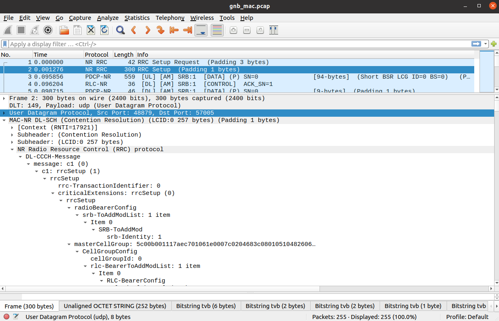
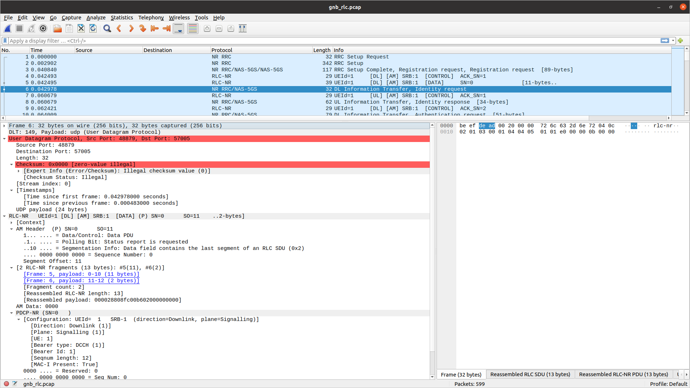
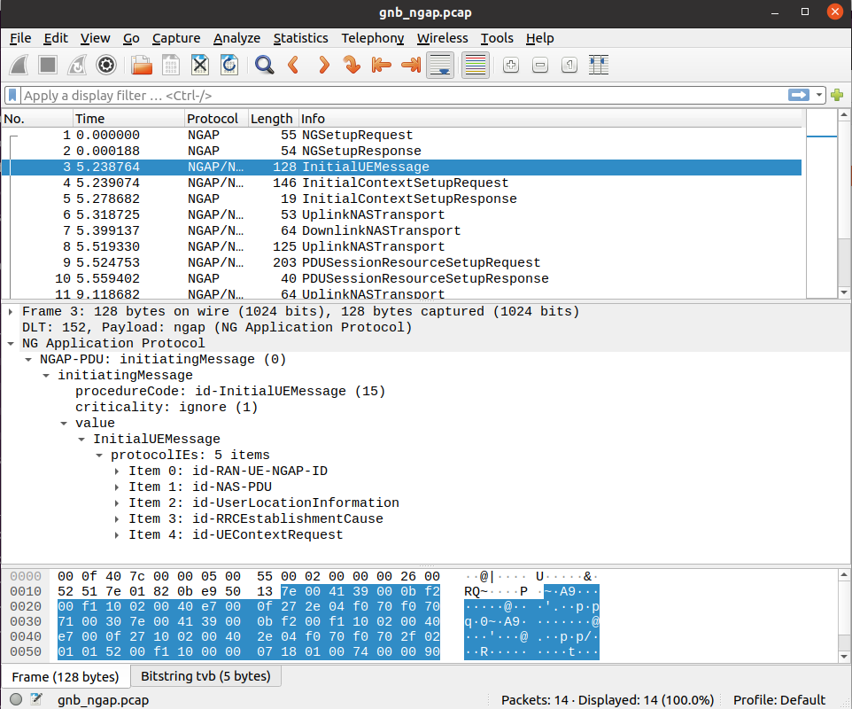
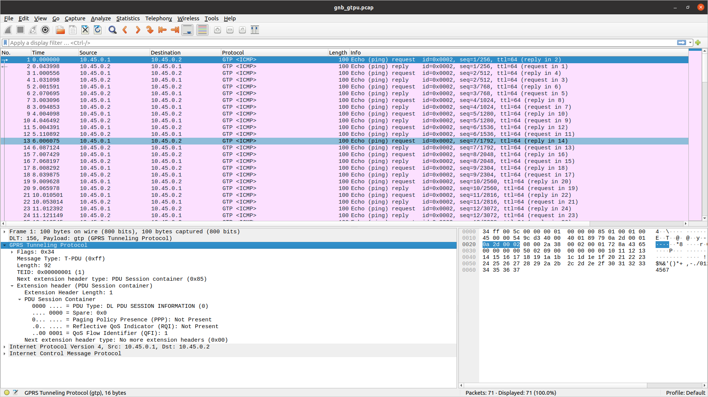
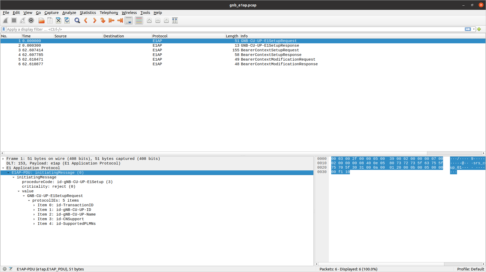
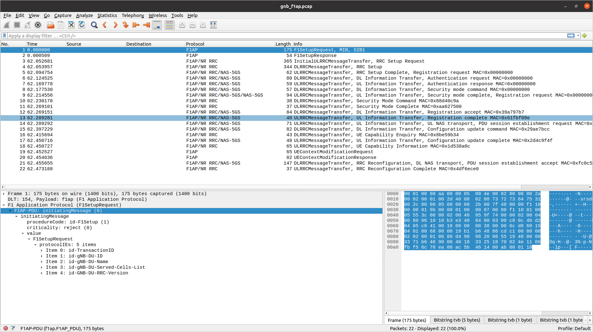
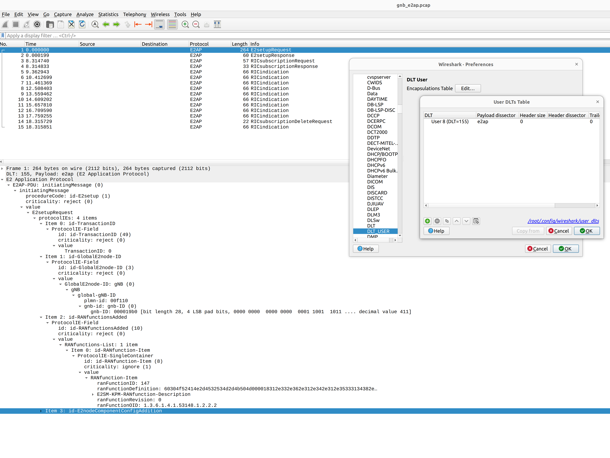

.. _manual_outputs:

Outputs
#######

Logs
****

|project_name| provides users with a highly configurable logging mechanism, with per-layer and per-component log levels. Set the log file path and log levels in the gNB config 
file. See the :ref:`Configuration Reference<manual_config_ref>` for more details.

The format used for all log messages is as follows:

    *Timestamp [Layer] [Level] [TTI] message*

Where the fields are:

    * Timestamp in *YYYY-MM-DDTHH:MM:SS.UUUUUU* format at which log message was generated
    * Layer can be one of *MAC/RLC/PDCP/RRC/SDAP/NGAP/GTPU/RADIO/FAPI/F1U/DU/CU/LIB*. PHY layers are specified as downlink or uplink and with executor number e.g. *DL-PHY1*.
    * Level can be one of *E/W/I/D* for error, warning, info and debug respectively.
    * TTI is only shown for PHY or MAC messages and is in the format *SFN.sn* where SFN is System Frame Number and sn is slot number.

An example log file excerpt can be seen below:

.. code-block::

    2023-03-15T18:29:25.142200 [MAC     ] [I] [  276.14] UL PDU rnti=0x4601 ue=0 subPDUs: [lcid=1: len=96, SBSR: lcg=0 bs=0, SE_PHR: total_len=3, PAD: len=424]
    2023-03-15T18:29:25.142204 [RLC     ] [I] ue=0 SRB1 UL: RX PDU. pdu_len=96 dc=data p=1 si=full sn=0 so=0
    2023-03-15T18:29:25.142226 [PDCP    ] [I] ue=0 SRB1 UL: RX PDU. type=data pdu_len=94 sn=0 count=0
    2023-03-15T18:29:25.142228 [PDCP    ] [I] ue=0 SRB1 UL: RX SDU. count=0
    2023-03-15T18:29:25.142245 [RRC     ] [D] ue=0 SRB1 - Rx DCCH UL rrcSetupComplete (88 B)
    2023-03-15T18:29:25.142249 [RRC     ] [D] Content: [
      {
        "UL-DCCH-Message": {
          "message": {
            "c1": {
              "rrcSetupComplete": {
                "rrc-TransactionIdentifier": 0,
                "criticalExtensions": {
                  "rrcSetupComplete": {
                    "selectedPLMN-Identity": 1,
                    "registeredAMF": {
                      "amf-Identifier": "000000100000000001000000"
                    },
                    "guami-Type": "native",
                    "dedicatedNAS-Message": "7e01820be950137e004139000bf200f110020040e7000f272e04f070f0707100307e004139000bf200f110020040e7000f27100200402e04f070f0702f0201015200f11000000718010074000090530101"
                  }
                }
              }
            }
          }
        }
      }
    ]
    2023-03-15T18:29:25.142253 [RRC     ] [D] ue=0 "RRC Setup Procedure" finished successfully
    2023-03-15T18:29:25.142263 [NGAP    ] [I] ue=0 Sending InitialUeMessage (ran_ue_id=0)

----

.. _pcaps:

PCAPs
*****

|project_name| can output PCAPs at the following layers: 

  - MAC
  - RLC
  - NGAP
  - N3
  - E1AP
  - F1AP
  - E2AP

To output these PCAPs, they must first be enabled on a per-layer basis in the gNB configuration file. See the :ref:`Configuration Reference<manual_config_ref>` for more details.

MAC
===

To analyze a MAC-layer PCAP using Wireshark, you will need to configure User DLT 149 for UDP and enable the mac_nr_udp protocol:

  #. Go to Edit->Preferences->Protocols->DLT_USER->Edit and add an entry with DLT=149 and Payload protocol=udp.
  #. Go to Edit->Preferences->Protocols->DLT_USER->Edit and add an entry with DLT=157 and Payload protocol=mac-nr-framed.
  #. Go to Analyze->Enabled Protocols->MAC-NR and enable mac_nr_udp
  #. Go to Edit->Preferences->Protocols->MAC-NR: Enable both checkboxes "Attempt to..."; Set LCID->DRB mapping to "From configuration protocol".

RLC
===

.. note:: 

  To correctly view the RLC PCAPs you will need Wireshark v4.3.x or later. 

To analyze a RLC-layer PCAP using Wireshark, you will need to configure User DLT 149 for UDP and enable the rlc_nr_udp protocol:

  #. Go to Edit->Preferences->Protocols->DLT_USER->Edit and add an entry with DLT=149 and Payload protocol=udp.
  #. Go to Analyze->Enabled Protocols->RLC-NR and enable rlc_nr_udp
  #. Go to Edit->Preferences->Protocols->RLC-NR and configure according to your needs.

NGAP
====

To analyze an NGAP-layer PCAP using Wireshark, you will need to configure User DLT 152 for NGAP and enable detection and decoding 5G-EA0 ciphered messages:

  #. Go to Edit->Preferences->Protocols->DLT_USER->Edit and add an entry with DLT=152 and Payload protocol=ngap.
  #. Go to Edit->Preferences->Protocols->NAS-5GS and enable "Try to detect and decode 5G-EA0 ciphered messages".

N3
=====

To analyze a N3 PCAP using Wireshark, you will need to configure User DLT 156 for GTP:

  #. Go to Edit->Preferences->Protocols->DLT_USER->Edit and add an entry with DLT=156 and Payload Protocol=gtp.

E1AP
=====

To analyze an E1AP PCAP using Wireshark, you will need to configure User DLT 153 for E1AP:

  #. Go to Edit->Preferences->Protocols->DLT_USER->Edit and add an entry with DLT=153 and Payload Protocol=e1ap.

F1AP
=====

To analyze an F1AP PCAP using Wireshark, you will need to configure User DLT 154 for F1AP:

  #. Go to Edit->Preferences->Protocols->DLT_USER->Edit and add an entry with DLT=154 and Payload Protocol=f1ap.

.. _e2ap_pcap:

E2AP
====

To analyze an E2AP PCAP using Wireshark, you will need to configure User DLT 155 for E2AP:

  #. Go to Edit->Preferences->Protocols->DLT_USER->Edit and add an entry with DLT=155 and Payload Protocol=e2ap.

-----

JSON Metrics
************

|project_name| supports the reporting of the console metrics to a JSON file over UDP socket. This is used to generate the output seen in the :ref:`GrafanaGUI <grafana_gui>`. 

The metrics can be received and written to a file using a Python script. To do this a Python UDP receiver is needed. 

Firstly, the metrics output can be enabled by adding the following to your configuration file: 

.. code-block:: yaml 

  metrics: 
    enable_json: true

With this enabled, the metrics will be sent to ``127.0.0.1:55555``. The metrics can be written to a file in real-time while the gNB is running using the following Python code: 

.. literalinclude:: .scripts/metrics_udp_receiver.py
  :language: python

This application will need to be run in parallel with the gNB to successfully write the metrics. The metrics will be written to a file called ``gnb_metrics.json``, which will be stored in 
the same location as where the Python application was run. 

You can download the source-code for the above Python application :download:`here <.scripts/metrics_udp_receiver.py>`. 

The metrics are generated on a layer basis, and each layer can be enabled through the configuration file.

.. code-block:: yaml 

  metrics: 
    layers:                    # Enable metrics per layer
      enable_executor: true    # false to disable
      enable_app_usage: true   # false to disable
      enable_ngap: true        # false to disable
      enable_rrc: true         # false to disable
      enable_e1ap: true        # false to disable
      enable_pdcp: true        # false to disable
      enable_sched: true       # false to disable
      enable_rlc: true         # false to disable
      enable_mac: true         # false to disable
      enable_du_low: true      # false to disable
      enable_ru: true          # false to disable
  

.. _mac_metrics:

MAC metrics
===========

The MAC metrics are encapsulated in the DU metric object, which contains the following keys:

  - ``du``: Includes the DU high metrics under the ``du_high`` key, which contains the ``mac`` metrics, which in turn contains ``dl`` metrics, which is a list of cells with specific MAC dowlink metrics. Each entry in the ``dl`` list corresponds to a cell configured in the DU.
  - ``timestamp``: Date and time at which the metrics were generated.

and is structured as shown below.

.. code-block::

  {
    "du": {
      "du_high": {
        "mac": {
          "dl": [   # List of cells, one item with MAC metrics per cell.
            {
              "average_latency_us": 45.473, "cpu_usage_percent": 0.0045473, "max_latency_us": 255.174, "min_latency_us": 6.918, "pci": 1
            },
            {
              "average_latency_us": 44.533, "cpu_usage_percent": 0.0044533, "max_latency_us": 232.088, "min_latency_us": 5.822, "pci": 2
            }
          ]
        }
      }
    },
    "timestamp": "2025-11-04T15:51:26.845"
  }

The table below describes the MAC metrics reported in the DU metrics JSON output, under the ``dl`` key.

.. list-table::
  :width: 100 %
  :widths: 25 75
  :header-rows: 1

  * - **MAC metrics**
    - **Description**
  * - ``pci``
    - Physical cell ID.
  * - ``average_latency_us``
    - Average latency of the MAC at handling slot indications, in microseconds.
  * - ``cpu_usage_percent``
    - Average CPU usage percentage of the MAC handling slot indications.
  * - ``min_latency_us``, ``max_latency_us``
    - Minimum/Maximum latency of the MAC at handling slot indications, in microseconds.

.. _scheduler_metrics:

Scheduler metrics
=================

The scheduler metrics object contains 2 keys:

  - ``cells``: List of cell metrics objects, one per cell configured in the DU; this list is accessed through the key ``cells``, which is structured similarly as shown below:
  - ``timestamp``: Date and time at which the metrics were generated.

.. code-block::
  
  {
    "cells": [   # List of cells, one metric object per cell.
      {
        "cell_metrics": {
          "average_latency": 3,
          ... 
        },
        "event_list": [   # List of events for this cell.
          {
            "event_type": "ue_create",
            "rnti": 17921,
            "slot": "50.5"
          },
          ...
        ],
        "ue_list": [   # List of UEs for this cell with their metrics.
          {
            "avg_ce_delay": 3.75,
            ...
          }
        ]
      },
      ...
    ],
    "timestamp": "2025-11-04T02:12:48.105"
  }
  

Each element of the ``cells`` list contains the metrics of the cell, which can be accessed through the following keys:

  - ``cell_metrics``: reports the cell metrics for a given cell; refer to :ref:`scheduler_cell_metrics` for details. 
  - ``event_list``: list of events reported in this cell metric report. Refer to :ref:`cell_events` for details.
  - ``ue_list``: reports the list of UEs connected to this cell; each UE entry contains the UE metrics described in :ref:`scheduler_ue_metrics`.

.. _scheduler_cell_metrics:

Scheduler cell metrics
======================

.. list-table::
  :width: 100 %
  :widths: 25 75
  :header-rows: 1

  * - **Scheduler cell metric**
    - **Description**
  * - ``error_indication_count``
    - Number of error indications received by the scheduler from lower layers.
  * - ``average_latency``, ``max_latency``
    - Average/Maximum scheduler decision latency in microseconds.
  * - ``nof_failed_pdcch_allocs``
    - Number of failed PDCCH allocation attempts.
  * - ``nof_failed_uci_allocs``
    - Number of failed UCI allocation attempts.
  * - ``latency_histogram``
    - Scheduler decision latency histogram: each bucket counts the number of scheduling decisions that took a latency within a specific range. Each bucket range is 50 microseconds, starting from 0 microseconds up to 500 microseconds.
  * - ``msg3_nof_ok``, ``msg3_nof_nok``
    - Number of MSG3s correctly received/decoded (CRC=OK) / not correctly received/decoded (CRC=KO).
  * - ``avg_prach_delay``
    - Average PRACH delay in slots: it measures the time between the slot when the PRACH is received by PHY layer and the slot when the PRACH indication reach the scheduler. Value is `null` if no PRACH was received during the measurement period.
  * - ``late_dl_harqs``
    - Number of failed PDSCH allocations due to late HARQs.
  * - ``late_ul_harqs``
    - Number of failed PUSCH allocations due to late HARQs.
  * - ``pucch_tot_rb_usage_avg``
    - Average number of RBs per UL slot used for PUCCH grants.
  * - ``pusch_prbs_used_per_tdd_slot_idx``
    - Sum of the number of RBs per slot used for PUSCH grants. Each entry in the array corresponds to a TDD slot index.
  * - ``pdsch_prbs_used_per_tdd_slot_idx``
    - Sum of the number of RBs per slot used for PDSCH grants. Each entry in the array corresponds to a TDD slot index.
  * - ``ue_list``
    - List of UE metrics reported in this cell metric report. Refer to :ref:`scheduler_ue_metrics` for details.

.. _cell_events:

Cell events
===========

.. list-table::
  :width: 100 %
  :widths: 25 75
  :header-rows: 1

  * - **Metric**
    - **Description**
  * - ``event_type``
    -  Possible events are: `ue_create` for UE creation, `ue_reconf` for UE reconfiguration, `ue_rem` for UE removal.
  * - ``rnti``
    -  RNTI of the UE for which the event occured.    
  * - ``slot``
    -  Slot at which the creation/reconfiguration/removal procedure was completed in the scheduler.    

.. _scheduler_ue_metrics:

Scheduler UE metrics
====================

.. list-table::
  :width: 100 %
  :widths: 25 75
  :header-rows: 1

  * - **Metric**
    - **Description**
  * - ``ue``
    - UE index in the DU for this UE.
  * - ``pci``
    - Physical cell id.
  * - ``rnti``
    - Currently used C-RNTI for this UE.
  * - ``cqi``
    - Mean Channel Quality Indicator.
  * - ``dl_ri``
    - Mean Downlink Rank Indicator.
  * - ``ul_ri``
    - Mean Uplink Rank Indicator.
  * - ``dl_mcs``
    - Average MCS index used for DL grants.
  * - ``dl_brate``
    - Experienced MAC DL bit rate in kbps, considering the size of the allocated MAC DL PDUs for which a positive HARQ-ACK was received.
  * - ``dl_nof_ok``
    - Number of positive DL HARQ-ACKs received.
  * - ``dl_nof_nok``
    - Number of detected DL HARQ NACKs or DL HARQ-ACK misdetections.
  * - ``dl_bs``
    - Sum of the last DL buffer occupancy reports of all logical channels.
  * - ``pusch_snr_db``
    - SNR in dB estimated for the PUSCH.
  * - ``pusch_rsrp_db``
    - RSRP in dB estimated for the PUSCH.
  * - ``pucch_snr_db``
    - SNR in dB estimated for the PUCCH.
  * - ``ta_ns``
    - Average Timing Advance in nanoseconds: it includes the TA offset for all UL grants.
  * - ``pusch_ta_ns``
    - Average Timing advance in nanoseconds: it includes the TA offset for PUSCH grants only.
  * - ``pucch_ta_ns``
    - Average Timing advance in nanoseconds: it includes the TA offset for PUCCH grants only.
  * - ``srs_ta_ns`` 
    - Average Timing advance in nanoseconds: it includes the TA offset for SRS grants only.
  * - ``ul_mcs``
    - Average MCS index used for UL grants.
  * - ``ul_brate``
    - Experienced MAC UL bit rate in kbps, considering the size of the allocated MAC UL PDUs for which the respective CRC was decoded.
  * - ``ul_nof_ok``
    - Number of PUSCH grants positively decoded (CRC=OK).
  * - ``ul_nof_nok``
    - Number of PUSCH grants that could not be decoded (CRC=KO).
  * - ``last_phr``
    - Last PHR value reported.
  * - ``max_pusch_distance``
    - Maximum interval in slots between 2 consecutive PUSCH allocated to this UE.
  * - ``max_pdsch_distance``
    - Maximum interval in slots between 2 consecutive PDSCH allocated to this UE.
  * - ``bsr``
    - Sum of the last UL buffer status reports (BSRs) of all logical channel groups.
  * - ``nof_pucch_f0f1_invalid_harqs``
    - Number of invalid UCI carrying HARQ-ACK bits detected on PUCCH format 0 and 1.
  * - ``nof_pucch_f2f3f4_invalid_harqs``  
    - Number of invalid UCI carrying HARQ-ACK bits detected on PUCCH format 2, 3 and 4.
  * - ``nof_pucch_f2f3f4_invalid_csis`` 
    - Number of invalid UCI carrying bits CSIs detected on PUCCH format 2, 3 and 4.
  * - ``nof_pusch_invalid_harqs`` 
    - Number of invalid UCI carrying HARQ-ACK bits detected on PUSCH.
  * - ``nof_pusch_invalid_csis``
    - Number of invalid UCI carrying CSI bits detected on PUSCH.
  * - ``avg_ce_delay``, ``max_ce_delay``
    - Average/Maximum MAC CE decoding delay in ms: it measures the time between the slot when the MAC PDU carrying the MAC CE is received and the slot when the MAC CE processing is completed.
  * - ``avg_crc_delay``, ``max_crc_delay``
    - Average/Maximum CRC decoding delay in ms: it measures the time between the slot when the MAC PDU carrying the PUSCH is received and the slot when the PUSCH processing is completed.
  * - ``avg_pusch_harq_delay``, ``max_pusch_harq_delay``
    - Average/Maximum PUSCH HARQ delay in ms: it measures the time between the slot when the PUSCH is received and the slot when the UCI carrying HARQ-ACK bits for that PUSCH decoding is completed.
  * - ``avg_pucch_harq_delay``, ``max_pucch_harq_delay``
    - Average/Maximum PUCCH HARQ delay in ms: it measures the time between the slot when the PUCCH is received and the slot when the UCI carrying HARQ-ACK bits for that PUCCH decoding is completed.
  * - ``avg_sr_to_pusch_delay``, ``max_sr_to_pusch_delay``
    - Average/Maximum SR to PUSCH delay in ms: it measures the time between the slot when the SR is received and the slot when the first PUSCH (following the SR) is allocated for this UE.    

.. _ofh_metrics:

OFH metrics
===========

The structured OFH metrics are shown below:

.. code-block:: json

  {
    "timestamp": "2025-11-04T15:51:26.845",
    "ru": {
      "ofh": {
        "timing_stats": {
          "nof_skipped_symbols": 0,
          "skipped_symbols_max_burst": 0
        },
        "cells": [    # List of cells.
          {
            "pci": 0,
            "ul": {
              "received_packets": {
                "total": 0,
                "early": 0,
                "on_time": 0,
                "late": 0,
                "earliest_msg_us": 0.0,
                "latest_msg_us": 0.0
              },
              "ethernet_receiver": {
                "average_throughput_mbps": 0.0,
                "average_latency_us": 0.0,
                "max_latency_us": 0.0,
                "cpu_usage_percent": 0.0
              },
              "message_decoder": {
                "prach": {
                  "nof_dropped_messages": 0,
                  "average_latency_us": 0.0,
                  "max_latency_us": 0.0,
                  "cpu_usage_percent": 0.0
                },
                "data": {
                  "nof_dropped_messages": 0,
                  "average_latency_us": 0.0,
                  "max_latency_us": 0.0,
                  "cpu_usage_percent": 0.0
                },
                "ecpri": {
                  "nof_future_seqid_messages": 0,
                  "nof_past_seqid_messages": 0
                }
              },
              "rx_window_stats": {
                "nof_missed_uplink_symbols": 0,
                "nof_missed_prach_occasions": 0
              }
            },
            "dl": {
              "ethernet_transmitter": {
                "average_throughput_mbps": 0.0,
                "average_latency_us": 0.0,
                "max_latency_us": 0.0,
                "cpu_usage_percent": 0.0
              },
              "message_encoder": {
                "dl_cp": {
                  "average_latency_us": 0,
                  "max_latency_us": 0,
                  "cpu_usage_percent": 0
                },
                "ul_cp": {
                  "average_latency_us": 0,
                  "max_latency_us": 0,
                  "cpu_usage_percent": 0
                },
                "dl_up": {
                  "average_latency_us": 0,
                  "max_latency_us": 0,
                  "cpu_usage_percent": 0
                },
              },
              "message_transmitter": {
                "average_latency_us": 0,
                "max_latency_us": 0,
                "cpu_usage_percent": 0
              },
              "transmitter_stats": {
                "late_dl_slots": 0,
                "late_ul_slot_requests": 0,
                "late_cp_dl_messages": 0,
                "late_up_dl_messages": 0,
                "late_cp_ul_messages": 0
              }
            }
          }
        ]
      }
    }
  }

The OFH metrics are structured into the following sections:

* ``timing_stats`` representing the timing statistics.
* ``cells`` representing a list of cells metrics.

The ``timing_stats`` metrics are shown in the following table:

.. list-table::
  :width: 100 %
  :widths: 25 75
  :header-rows: 1

  * - **OFH timing_stats metrics**
    - **Description**
  * - ``nof_skipped_symbols``
    - Number of symbols skipped when the timing worker wakes up late.
  * - ``skipped_symbols_max_burst``
    - Maximum number of skipped symbols in a burst.

A cell is composed of three elements as it is shown in the following table:

.. list-table::
  :width: 100 %
  :widths: 25 75
  :header-rows: 1

  * - **OFH cells metrics**
    - **Description**
  * - ``pci``
    - Physical Cell Identifier (described in 3GPP TS 38.331). Supported [0 - 1007].
  * - ``ul``
    - Object holding the Uplink metrics for the given cell.
  * - ``dl``
    - Object holding the Downlink metrics for the given cell.

The Uplink metrics are structured in the following sections:

* ``received_packets``
* ``ethernet_receiver``
* ``message_decoder``
* ``rx_window_stats``

The Received packets metrics for Uplink are described in the following table:

.. list-table::
  :width: 100 %
  :widths: 25 75
  :header-rows: 1

  * - **OFH Uplink cells received packets metrics**
    - **Description**
  * - ``total``
    - Total number of received packets.
  * - ``early``
    - Number of OFH packets received early.
  * - ``on_time``
    - Number of OFH packets received on time.
  * - ``late``
    - Number of OFH packets received late.
  * - ``earliest_msg_us``
    - Earliest received packet in microseconds.
  * - ``latest_msg_us``
    - Latest received packet in microseconds.

The Ethernet receiver metrics for Uplink is described in the following table:

.. list-table::
  :width: 100 %
  :widths: 25 75
  :header-rows: 1

  * - **OFH cell Ethernet receiver metrics**
    - **Description**
  * - ``average_throughput_mbps``
    - Average received throughput during metrics period represented in megabits per second.
  * - ``average_latency_us``
    - Average latency of packet reception in microseconds.
  * - ``max_latency_us``
    - Maximum latency of packet reception in microseconds.
  * - ``cpu_usage_percent``
    - CPU usage in percentage of the Ethernet receiver.

The Uplink message decoder metrics are structured in the following sections:

* ``prach``
* ``data``
* ``ecpri``

The PRACH metrics for Uplink message decoder are described in the following table:

.. list-table::
  :width: 100 %
  :widths: 25 75
  :header-rows: 1

  * - **OFH cell PRACH messages decoder metrics**
    - **Description**
  * - ``nof_dropped_messages``
    - Number of dropped PRACH messages.
  * - ``average_latency_us``
    - Average latency of PRACH message decoding.
  * - ``max_latency_us``
    - Maximum latency of PRACH message decoding.
  * - ``cpu_usage_percent``
    - CPU usage in percentage of PRACH messages decoding.

The Data metrics for Uplink message decoder are described in the following table:

.. list-table::
  :width: 100 %
  :widths: 25 75
  :header-rows: 1

  * - **OFH cell Data messages decoder metrics**
    - **Description**
  * - ``nof_dropped_messages``
    - Number of dropped Data messages.
  * - ``average_latency_us``
    - Average decoding latency of the received Data messages.
  * - ``max_latency_us``
    - Maximum decoding latency of the received Data messages.
  * - ``cpu_usage_percent``
    - CPU usage in percentage of the Data flow.

The eCPRI metrics for Uplink message decoder are described in the following table:

.. list-table::
  :width: 100 %
  :widths: 25 75
  :header-rows: 1

  * - **OFH Uplink cells message decoder eCPRI metrics**
    - **Description**
  * - ``nof_future_seqid_messages``
    - Number of skipped messages by the eCPRI.
  * - ``nof_past_seqid_messages``
    - Number of dropped messages by the eCPRI.

The Receiver window statistics metrics for Uplink are described in the following table:

.. list-table::
  :width: 100 %
  :widths: 25 75
  :header-rows: 1

  * - **OFH Uplink cells Receiver window statistics metrics**
    - **Description**
  * - ``nof_missed_uplink_symbols``
    - Number of requested uplink symbols that were not fully received within the expected reception window.
  * - ``nof_missed_prach_occasions``
    - Number of PRACHs that were not fully received within the expected reception window.

The Downlink metrics are structured in the following sections:

* ``ethernet_transmitter``
* ``message_encoder``
* ``message_transmitter``
* ``transmitter_stats``

The Ethernet transmitter metrics for Downlink are described in the following table:

.. list-table::
  :width: 100 %
  :widths: 25 75
  :header-rows: 1

  * - **OFH cell Ethernet transmitter metrics**
    - **Description**
  * - ``average_throughput_mbps``
    - Average transmitted throughput during metrics period represented in megabits per second.
  * - ``average_latency_us``
    - Average latency of packet transmission in microseconds.
  * - ``max_latency_us``
    - Maximum latency of packet transmission in microseconds.
  * - ``cpu_usage_percent``
    - CPU usage in percentage of the Ethernet transmitter.

The Downlink message encoder metrics are structured in the following sections:

* ``dl_cp``
* ``ul_cp``
* ``dl_up``

The message encoder Downlink Control-Plane metrics are described in the following table:

.. list-table::
  :width: 100 %
  :widths: 25 75
  :header-rows: 1

  * - **OFH cell Downlink Control-Plane messages encoder metrics**
    - **Description**
  * - ``average_latency_us``
    - Average latency of the Downlink Control-Plane processing in microseconds.
  * - ``max_latency_us``
    - Maximum latency of the Downlink Control-Plane processing in microseconds.
  * - ``cpu_usage_percent``
    - CPU usage in percentage of the Downlink Control-Plane processing.

The message encoder Uplink Control-Plane metrics are described in the following table:

.. list-table::
  :width: 100 %
  :widths: 25 75
  :header-rows: 1

  * - **OFH cell Uplink Control-Plane messages encoder metrics**
    - **Description**
  * - ``average_latency_us``
    - Average latency of the Uplink Control-Plane processing in microseconds.
  * - ``max_latency_us``
    - Maximum latency of the Uplink Control-Plane processing in microseconds.
  * - ``cpu_usage_percent``
    - CPU usage in percentage of the Uplink Control-Plane processing.

The Message encoder Downlink User-Plane metrics are described in the following table:

.. list-table::
  :width: 100 %
  :widths: 25 75
  :header-rows: 1

  * - **OFH cell Downlink User-Plane messages encoder metrics**
    - **Description**
  * - ``average_latency_us``
    - Average latency of the Downlink User-Plane processing in microseconds.
  * - ``max_latency_us``
    - Maximum latency of the Downlink User-Plane processing in microseconds.
  * - ``cpu_usage_percent``
    - CPU usage in percentage of the Downlink User-Plane processing.

The Message transmitter metrics for Downlink are described in the following table:

.. list-table::
  :width: 100 %
  :widths: 25 75
  :header-rows: 1

  * - **OFH cell messages transmitter metrics**
    - **Description**
  * - ``average_latency_us``
    - Average latency of messages processing (including Ethernet transmission) performed at each symbol boundary.
  * - ``max_latency_us``
    - Maximum latency of messages processing (including Ethernet transmission) performed at each symbol boundary.
  * - ``cpu_usage_percent``
    - CPU usage in percentage of the messages transmitter.

The Transmitter statistics for Downlink is described in the following table:

.. list-table::
  :width: 100 %
  :widths: 25 75
  :header-rows: 1

  * - **OFH Downlink cells transmitter statistics metrics**
    - **Description**
  * - ``late_dl_slots``
    - Number of late downlink resource grids received from the PHY.
  * - ``late_ul_slot_requests``
    - Number of late uplink request.
  * - ``late_cp_dl_messages``
    - Number of late Control-Plane downlink messages, i.e., messages that were not transmitted.
  * - ``late_up_dl_messages``
    - Number of late User-Plane downlink messages, i.e., messages that were not transmitted.
  * - ``late_cp_ul_messages``
    - Number of late Control-Plane uplink messages, i.e., messages that were not transmitted.

.. _executors_metrics:

Executors metrics
===========

The structured Executors metrics are shown below:

.. code-block:: json

  {
    "timestamp": "2025-11-04T15:51:26.845",
    "executor_metrics": {
      "name": "",
      "nof_executes": 0,
      "nof_defers": 0,
      "enqueue_avg": 0,
      "enqueue_max": 0,
      "task_avg": 0,
      "task_max": 0,
      "cpu_load": 0,
      "nof_vol_ctxt_switch": 0,
      "nof_invol_ctxt_switch": 0.0	
    }
  }

The table below describes the Executors metrics.

.. list-table::
  :width: 100 %
  :widths: 25 75
  :header-rows: 1

  * - **Executors metrics**
    - **Description**
  * - ``name``
    - Executor name.
  * - ``nof_executes``
    - Number of times executor ran a task.
  * - ``nof_defers``
    - Number of times a task execution was deferred.
  * - ``enqueue_avg``
    - Average task enqueueing latency in microseconds.
  * - ``enqueue_max``
    - Maximum task enqueueing latency in microseconds.
  * - ``task_avg``
    - Average task duration in microseconds.
  * - ``task_max``
    - Maximum task duration in microseconds.
  * - ``cpu_load``
    - Average CPU usage percentage of the executor.
  * - ``nof_vol_ctxt_switch``
    - Number of voluntary context switches during the report period.
  * - ``nof_invol_ctxt_switch``
    - Number of involuntary context switches during the report period.

.. _app_resource_usage_metrics:

Application resource usage metrics
===========

The structured Application resource usage metrics are shown below:

.. code-block:: json

  {
    "timestamp": "2025-11-04T15:51:26.845",
    "app_resource_usage": {
      "cpu_usage_percent": 0,
      "memory_usage_mb": 0,
      "power_consumption_watts": 0
    }
  }

The table below describes the Application resource usage metrics.

.. list-table::
  :width: 100 %
  :widths: 25 75
  :header-rows: 1

  * - **Application resource usage metrics**
    - **Description**
  * - ``cpu_usage_percent``
    - CPU usage of the application as a percentage. It can exceed 100% indicating how many CPU cores are utilized.
  * - ``memory_usage_mb``
    - Memory consumption of the application in Megabytes.
  * - ``power_consumption_watts``
    - CPU package power consumption in Watts measured while running the application.
